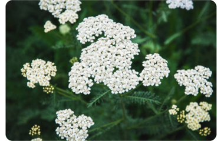

# Accessible Website

Ontwerp en maak voor een opdrachtgever een website toegankelijk volgens WCAG richtlijnen.

* Huidige versie: https://noeyoo26.github.io/all-human-accessible-website-sprint3/
* 1ste versie: https://noeyoo26.github.io/the-client-website-sprint2/

## Inhoudsopgave

  * [Beschrijving](#beschrijving)
  * [Kenmerken](#kenmerken)
  * [Bronnen](#bronnen)
  * [Licentie](#licentie)

## Beschrijving
Voor deze sprint heb ik het eerdere ontwerp voor Bloemenveld Frankendael doorontwikkeld met een sterke focus op toegankelijkheid (WCAG). De applicatie is nu volledig responsief en uitgebreid met een nieuwe overzichtspagina voor de plantencollectie.


## Kenmerken
Voor dit prototype ligt de focus op responsive design, hoog kleurcontrast en de nieuwe Plantencollectie-pagina. De toegankelijkheid is volledig opgebouwd met native HTML (zonder ARIA-attributen) via de volgende onderdelen:   

+ 1
De plant-pin op de kaart is een native `<button type="button">` Hierdoor werkt hij direct met het toetsenbord, zonder dat er ARIA nodig

```html
<header class="app-header">
            <button class="menu-btn" type="button">
            &#9776;
            <span class="visually-hidden">Menu</span>
            </button>
            <h1>Veldverkenner</h1>
        </header>
```

+ 2
.visually-hidden: Utility class om visueel verborgen context mee te geven aan schermlezers (zoals labels bij icoonknoppen en sectiekoppen).   

```css
.visually-hidden{
    position: absolute;
    width: 1px;
    height: 1px;
    padding: 0px;
    margin: -1px;
    overflow: hidden;
}
```
```html
 <nav class="bottom-nav">
            <h2 class="visually-hidden">Hoofdnavigatie</h2>
            <ul>
                <li>
                    <a href="index.html" class="nav-item">
                        <span class="nav-icon"></span>
                        <span class="nav-text">Home</span>
                    </a>
                </li>
```

+ 3
alt-attributen: Betekenisvolle beschrijvingen voor inhoudelijke afbeeldingen en lege alt-tags (alt="") voor decoratieve iconen.

```html

```
* Bekijk de testresultaten en verbeteringen in mijn issue: https://github.com/Noeyoo26/all-human-accessible-website-sprint3/issues/3#issue-6104507703

***
### Responsive design (@media)
Met een media query schaalt de lay-out automatisch mee voor grotere schermen (vanaf 768px). De plantencollectie verandert op desktop bijvoorbeeld van een enkele lijst naar een overzichtelijk 2-koloms grid:

```css
@media (min-width: 768px) {
  .plant-list {
    display: grid;
    grid-template-columns: repeat(2, 1fr);
    gap: 20px;
    align-items: start;
  }
}
```


## Bronnen

## Licentie
This project is licensed under the terms of the [MIT license](./LICENSE).
